# Data model (P0)

Source of truth is `packages/db/src/schema/*.ts` plus the hand-written RLS migration `packages/db/drizzle/0001_rls.sql`. This page explains it; if they disagree, the code wins and this page is wrong.

## 1. ER diagram

```mermaid
erDiagram
  users ||--o{ sessions : has
  users ||--o{ accounts : has
  users ||--o{ investigations : owns
  investigations ||--o{ run_events : emits
  investigations ||--o{ inv_entities : snapshot
  investigations ||--o{ inv_relationships : snapshot
  investigations ||--o{ inv_actors : snapshot
  investigations ||--o{ inv_sources : snapshot
  investigations ||--|| inv_summary : snapshot
  investigations ||--o{ inv_exports : snapshot
  investigations ||--o| run_costs : measured
  users ||--o{ credit_ledger : "append-only"
  users ||--o{ topup_lots : buys
  topup_lots ||--o{ credit_ledger : "lot_id"
  users ||--o{ subscriptions : has
  users ||--o{ payments : pays
  users ||--o| founding_seats : holds
  users ||--o{ founding_notices : "notified by"
  users ||--o{ credential_vault : "encrypted values"
  users ||--o{ events : "funnel (nullable)"
  users ||--o{ abuse_flags : "flagged (nullable)"
  archive_entities ||--o{ archive_observations : seen
  archive_sources ||--o{ archive_observations : "seen at"
  archive_entities ||--o{ archive_relationships : a
  archive_entities ||--o{ archive_aliases : known_as
```

The archive group (bottom four lines) has **no edge to any tenant table**, by design (see §4).

## 2. Tables, grouped, and which lane writes them

| Group | Tables | Class | Written by |
|---|---|---|---|
| Auth | `users`, `sessions`, `accounts`, `verifications` | tenant (`verifications`: system-only) | P2 (Better Auth adapter, on the system role) |
| Investigations | `investigations` | tenant, app role may insert/update/delete own | P2 (create, cancel), runner callbacks (status) via system |
| | `run_events` | tenant, app read-only | callbacks route (P2) via system |
| Snapshots | `inv_entities`, `inv_relationships`, `inv_actors`, `inv_sources`, `inv_summary`, `inv_exports` | tenant, app read-only, **immutable** (UPDATE blocked by trigger) | P3 ingest via system |
| Credits | `credit_ledger`, `topup_lots`, view `credit_balances` | tenant, **append-only** | `packages/db/src/ledger.ts`: P2 (reserve), P5 (grants, top-ups), watchdog/cron (refund, expiry) |
| Billing | `subscriptions`, `payments` | tenant, app read-only | P5 webhooks via system |
| Founding | `founding_seats` (100 fixed rows), `founding_notices` | seats: own-row read; notices: tenant read-only | `founding.ts`: P5 (claim), cron (checks); P6 sends notices |
| Platform | `events`, `abuse_flags`, `audit_log`, `run_costs` | system-only | P6 (events, abuse, admin), runner/callbacks (costs), every `withSystem` call (audit) |
| Vault | `credential_vault` | system-only, envelope-encrypted | P3 ingest (`storeCredential`), admin unmask (`decryptCredential`) |
| Archive | `archive_entities`, `archive_sources`, `archive_observations`, `archive_relationships`, `archive_aliases` | shared, app read-only, **no tenant columns** | P4 ingest via system |
| Waitlist | `waitlist` | owned by SITE (P1), not in P0 | P1 |

## 3. Tenant isolation model

**Roles** (created by migration `0001_rls.sql`):

| Role | Purpose | Notes |
|---|---|---|
| owner / migrator | runs migrations, owns tables and `SECURITY DEFINER` functions | never used by the running app; `MIGRATE_DATABASE_URL` |
| `va_app` | what the app connects as (`DATABASE_URL`) | not owner, not superuser, no BYPASSRLS. Least-privilege grants (below). Created `NOLOGIN`; ops sets `LOGIN PASSWORD` (the test harness does it for tests) |
| `va_system` | system work: webhooks, cron, admin, ingest | reachable only via `SET LOCAL ROLE` inside `withSystem`; `va_app` is a member **without inherit**, so system policies never apply to a plain app session |

**Two entry points, nothing else** (`packages/db/src/client.ts`):

- `withUser(userId, fn)`: opens a transaction and runs `set_config('app.user_id', <uuid>, true)` (transaction-local). Every tenant policy is `user_id = app_user_id()`, with the same expression as `WITH CHECK`, so reads, updates, deletes and inserts are all scoped, and a forged `user_id` on insert is rejected. With no user set, `app_user_id()` is NULL and nothing matches.
- `withSystem(reason, fn)`: transaction with `SET LOCAL ROLE va_system`; policy `system_all` (`USING true`). Requires a reason and writes an `audit_log` row (`action = system_tx`, `meta.reason`) unless `{ audit: false }` is passed explicitly. `grep -rn withSystem` lists every place that bypasses tenant scoping.

**Least privilege for `va_app`** (beyond RLS): read-only on snapshots, run events, billing and lots; `INSERT` on `credit_ledger` limited by policy to rows that are `reason = 'reserve' AND amount < 0` for the caller's own investigation (a user cannot mint credits); column-level `UPDATE` on `users` (name, image, profile fields, AUP timestamp only); no access to `accounts` (password hashes, tokens), `verifications`, `events`, `abuse_flags`, `audit_log`, `run_costs` or `credential_vault`. New tables get grants for `va_system` only (default privileges), so a table someone forgets to grant is closed to the app, not open.

**Guards that fail the build** (`packages/db/test/guards.test.ts`, `isolation.test.ts`): every public table has RLS unless explicitly allow-listed; every table with a `user_id` column must be covered by the isolation seed; the app role is not owner/superuser/BYPASSRLS and does not inherit `va_system`; cross-user reads, updates, deletes and forged inserts return nothing or fail for every tenant table, through `withUser` and through raw app-role SQL.

**Notes for lanes:**
- Better Auth looks up sessions before a user is known: its adapter must use `withSystem`.
- New tenant table: add `user_id uuid NOT NULL`, `ENABLE ROW LEVEL SECURITY`, an `own_rows` policy and a `system_all` policy (copy from `0001_rls.sql`), grant only what `va_app` needs, and add it to the isolation seed. The guard test will tell you if you forget.
- Migrations from different lanes share one drizzle journal; the architect resolves numbering when merging.

## 4. The archive has no tenant link

`archive_*` tables carry findings only: no `user_id`, no query text, no investigation id, no session or IP. `guards.test.ts` fails the build if any archive column name matches user/query/investigation/session/owner/account/tenant/email/ip or if an archive table gains a foreign key to a non-archive table. Ingest (P4) must write through `withSystem` from the bundle's entities and sources only.

## 5. Credits ledger

- Append-only: triggers block `UPDATE`/`DELETE`/`TRUNCATE` (even for the owner), and `va_system` has no `UPDATE`/`DELETE` grant. Users with ledger rows are anonymised, not hard-deleted (`ON DELETE RESTRICT`); `investigation_id` and `actor_id` are plain uuids with no FK so deleting an investigation never rewrites history.
- Every row has a unique `idempotency_key` (`reserve:<inv>:grant`, `reserve:<inv>:lot:<id>`, `refund:<inv>:…`, `grant:<user>:<period>`, `topup:<paymentRef>`, `expiry:lot:<id>`, `admin:<key>`).
- A `BEFORE INSERT` trigger takes a per-user advisory lock and refuses any insert that would take the grant bucket below zero; for top-up rows it updates `topup_lots.remaining`, which has `CHECK (0 <= remaining <= credits_initial)`. So no code path, including a buggy one, can overdraw or double-spend.
- Spend order: grant bucket, then lots by soonest `expires_at`. Expired-but-unswept lots are never spendable. `expireLots(now)` writes the `expiry` rows.
- `credit_balances` is `security_invoker`, so RLS applies to whoever queries it. It reflects ledger sums, so lots past expiry still show until `expireLots` runs.
- Stage weights for partial refunds live in `packages/db/src/stage-weights.ts` (request: move to `@voidaccess/config`).

## 6. Founding seats

`founding_seats` holds exactly 100 pre-inserted rows (`seat_no` 1–100, enforced by PK and CHECK). A seat is held while `holder_user_id IS NOT NULL` (unique). Claim is one `UPDATE … WHERE seat_no = (SELECT … FOR UPDATE SKIP LOCKED LIMIT 1)`, so 100 concurrent claims for the last 3 seats give exactly 3 winners. Paid months in the trailing 12 are derived from `payments` (distinct calendar months of `period_start` in `[anniversary − 12 months, anniversary)`); the last-investigation date is derived from `investigations`. `founding_notices` rows are scheduled by `runFoundingChecks`, deduped on `(user_id, kind, ref_at)`, and sent by the emails lane (`sent_at IS NULL AND scheduled_for <= now`). `availableSeats()` calls the `SECURITY DEFINER` function `founding_seats_available()`, which is safe to expose to the public pricing page.

## 7. Credential vault

Raw sensitive values exist only in `credential_vault.ciphertext` (AES-256-GCM, random DEK per value, DEK wrapped by Cloud KMS in production via `KMS_KEY_NAME`, or by a local KEK via `VA_LOCAL_KEK` in dev/test). Other tables store only `masked_value`/`display_value` and the HMAC fingerprint (`VA_FINGERPRINT_KEY`). `decryptCredential()` is the single decrypt path and writes an `audit_log` row (`credential.decrypt`, actor, reason) before decrypting.

## 8. Environment

| Variable | Used by |
|---|---|
| `DATABASE_URL` | app: `va_app` connection (RLS applies) |
| `MIGRATE_DATABASE_URL` | `pnpm --filter @voidaccess/db db:migrate`, `drizzle-kit`: owner connection |
| `TEST_DATABASE_URL` | tests: a superuser connection to any database on the test server; the harness drops and recreates `voidaccess_test` |
| `KMS_KEY_NAME` / `VA_LOCAL_KEK` | vault key wrapping (KMS in production, local KEK in dev/test) |
| `VA_FINGERPRINT_KEY` | HMAC fingerprints |
